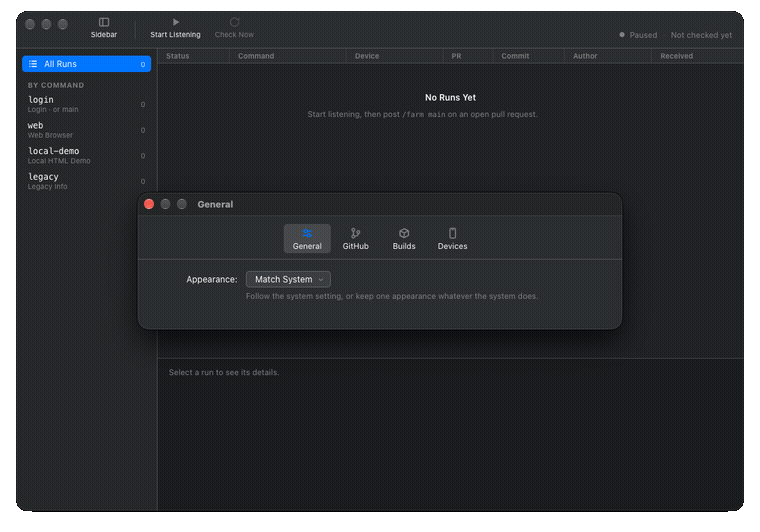

# Loupe

> Post `/farm <screen>` on a pull request → Loupe builds the commit, drives a simulator or emulator with Appium, and delivers a lossless PNG — all on your Mac, automatically.



One comment, one screen. Multiple screenshots when scrolling is needed. Results appear in the desktop app and can optionally be posted back to the PR.

Two projects are wired up, and a command means the same thing on either:

| Project | Platform | Device | Built with |
| --- | --- | --- | --- |
| [`azisramdhan/WebKitDemo`](https://github.com/azisramdhan/WebKitDemo) | iOS | Simulator | `xcodegen` + `xcodebuild` |
| [`azisramdhan/WebViewDemo`](https://github.com/azisramdhan/WebViewDemo) | Android | Emulator | Gradle wrapper |

---

## Prerequisites

| Requirement | Notes |
| --- | --- |
| macOS (Apple Silicon) | Unsigned build targets `mac-arm64` |
| Node.js `^22.23.4 \|\| ^24.22.1 \|\| >=26.12.1` | `.nvmrc` pins 22.23.4; run `nvm install && nvm use` |
| Xcode | Required for iOS builds |
| `xcodegen` | `brew install xcodegen` |
| JDK 17 | `brew install openjdk@17` |
| Android SDK | Set via `ANDROID_HOME=~/Library/Android/sdk` |
| Appium 2.x | `npm install -g appium` |

---

## How it works

1. The app polls both repositories' issue comments every 60 seconds.
2. A comment starting with `/farm` is parsed into one screen name and matched against the catalog of the project that owns the repository it arrived in.
3. The commenter must be OWNER, MEMBER or COLLABORATOR, and the comment must be on an open PR. The PR head SHA is pinned at detection.
4. The run is queued for a device of its own platform. One session per device, devices in parallel.
5. Appium installs the build registered for that SHA, walks the screen's navigation recipe, waits for the readiness locator and saves a lossless PNG under `artifacts/<sha>/<comment-id>/<screen>.png`.
6. **View screenshot** and **Show in Finder** appear on the run card.

By default results stay in the desktop app and a read-only token is enough. Tick **Post the screenshot back to the pull request** to publish them (see [Posting results](#posting-results-back-to-the-pr)).

---

## Screen targets

Every recipe starts from the app's launch screen. The Android app gives each control the same accessibility id as its iOS twin, so only the readiness checks differ between platforms.

| Command | Screen | Navigation | Readiness |
| --- | --- | --- | --- |
| `/farm main`, `/farm login` | `LoginViewController` / `LoginActivity` | launch only | `Log In` button |
| `/farm web` | `WebViewController` / `WebActivity` on example.com | type `admin` / `password`, dismiss keyboard, tap **Log In** | `WKWebView` appears |
| `/farm local-demo` | `WebViewController` / `LocalDemoActivity` on bundled HTML | tap **Skip to Local HTML Demo** | `WebKit Bridge Demo` heading |
| `/farm legacy` | `LegacyWebViewController` / `LegacyActivity` | tap **Skip to Local HTML Demo** → **Legacy** | `Legacy UIWebView Info` nav bar |

- `main` is an alias for `login`. Matching is case-insensitive.
- One screen name per comment, optionally followed by `--all` (see [Capture on all devices](#capture-on-all-online-devices)).
- Unknown screen names are recorded and rejected without touching the device.
- Quoted commands, code blocks, unsupported arguments and ordinary issues do not trigger a run.

Every locator is an identifier the app already sets — an `accessibilityIdentifier` on iOS, a `contentDescription` on Android — so neither demo app needs changes to be captured.

### Known app behaviour

`/farm web` captures WebKit's *"Attempted to navigate away from an app-bound domain"* alert. `WebKitDemo` declares `WKAppBoundDomains` in `App/Info.plist` but never sets `limitsNavigationsToAppBoundDomains` on the `WKWebViewConfiguration`, so the cookie injection in `WebViewController.loadURL` locks the web view before example.com loads. That is the app's real behaviour on this commit, captured faithfully.

---

## Setup

### 1. Install dependencies

```sh
npm ci
appium driver install --source=npm appium-xcuitest-driver@8.4.3
appium driver install --source=npm appium-uiautomator2-driver@3.9.4
```

### 2. Start every session

```sh
# Terminal 1 — Appium server
ANDROID_HOME=~/Library/Android/sdk appium --port 4723

# Terminal 2 — Loupe
npm start
```

> A simulator boots itself when a run starts; it only needs to exist. Use `xcrun simctl list devices` to find its UDID.  
> An Android emulator must already be running — use `adb devices` to find its serial.

### 3. Configure in the app

Save the following in Loupe's Settings:

| Setting | Value |
| --- | --- |
| **GitHub token** | Fine-grained; resource owner `azisramdhan`; repos `WebKitDemo` + `WebViewDemo`; Issues + Pull requests **read** |
| **Devices** | Simulator UDID (`xcrun simctl list devices`) and/or emulator serial (`adb devices`) |
| **Appium server** | `http://127.0.0.1:4723` |
| **Build directory** | Where SHA manifests live; defaults to `builds/` inside userData |

Then **Start listening** and post `/farm main` on an open PR. **Check now** skips the 60-second wait.

---

## Builds

Capture needs a build of the PR head SHA, pinned when the comment is detected. With **Build the commit automatically** on (the default), Loupe clones, checks out that exact commit, builds it and registers the manifest before touching the device.

- **iOS** — runs `xcodegen` + `xcodebuild`; needs Xcode + `brew install xcodegen`
- **Android** — runs `gradlew assembleDebug`; needs JDK 17 + Android SDK

Two devices asking for the same commit build it once and share the result. A commit already built is reused, so only the first `/farm` on a new commit pays the build time (a few minutes); later ones are seconds.

You can also pre-build or build manually with the CLI:

```sh
npm run build-sha -- WebKitDemo <40-char-sha>
npm run build-sha -- WebViewDemo <40-char-sha> /absolute/build-directory /absolute/checkout

npm run register-build -- WebKitDemo /absolute/build-directory <40-char-sha> /absolute/WebKitDemo.app
npm run register-build -- WebViewDemo /absolute/build-directory <40-char-sha> /absolute/app-debug.apk
```

With the toggle off, a run whose build is missing fails with the exact command to run, and **Retry same commit** re-runs it against the same commit.

---

## Posting results back to the PR

Off by default. When enabled, a completed capture:

1. Uploads the PNG to the orphan branch `loupe-artifacts` at `<sha>/<device>/<screen>.png`.
2. Creates **one comment per commit** on the PR, tagged with a hidden `<!-- loupe:<sha> -->` marker.

**No duplication** is the point of the design:

- A second screen on the same commit **joins the existing comment** as another entry.
- A retry of the same screen **overwrites** the image blob and **edits** the comment in place.
- A different commit gets its own comment, so history is kept per SHA.
- Only a comment carrying the marker is ever edited; human comments are never touched.

Screens taller than the display are captured in parts (scroll → shoot, up to 4 parts). Parts land as `<screen>.png`, `<screen>-2.png`, … A rerun that yields fewer parts deletes the extras.

> This needs a token with **Contents: write** and **Pull requests: write**. Posting failures never fail the run — the local PNG is kept and the card shows what went wrong.

Artifacts are public on a public repo (`raw.githubusercontent.com` serves them without a token). On a private repo, images only render for people who can already see the repo.

---

## Persistence and credentials

- The token is encrypted with Electron `safeStorage` at `~/Library/Application Support/Loupe/credential.json`.
- History, the polling cursor and artifacts live under `runs/` in userData, across both projects.
- First activation watches new comments only; later starts resume from the saved cursor.
- Each comment ID is processed once — post a fresh comment to run again.

---

## Capture on all online devices

`/farm local-demo --all` creates one job for each configured device the platform can reach. Unreachable devices are skipped; an empty selection is rejected. One build is shared, captures run in parallel, and publication is serialized into one result comment per commit with an entry per device.

---

## Deliberately out of scope

Single screen per comment, not the whole catalog. No commit status or check run, no physical devices, no video, no baseline diffing, no retention policy.

---

## Development

```sh
npm ci
npm test        # mocked GitHub and Appium, ~2s
npm start
npm run smoke   # launches the real Electron UI against isolated state
npm run pack
```

The unsigned Apple Silicon app builds into `dist/mac-arm64/Loupe.app`.

### Current flow

See [the Loupe flow diagram](docs/alur-device-farm.html). Publication retries transient network failures and HTTP 500/502/503/504 twice (after 1 and 2 seconds), re-reading remote state before each attempt. Permission errors are not retried; exhausted retries keep local screenshots and show a publishing error.
